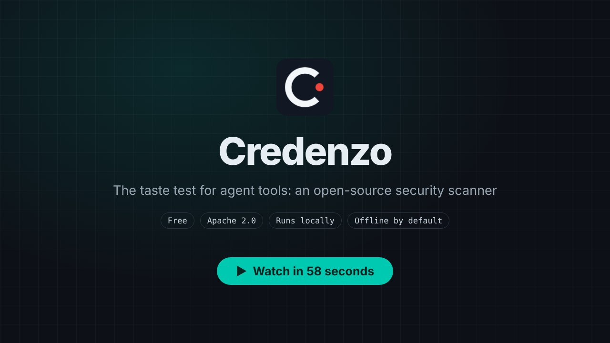

# Credenzo

**The taste test for agent tools.** Credenzo (formerly mcp-audit) is an offline security scanner and committable lock for the MCP servers your AI coding tools run.

> In 16th-century Italy, a *credenza* was the act of a servant who tasted a lord's food and drink to check for poison. Credenzo is the taster: it does that for the tools your agent consumes.
>
> **mcp-audit is now Credenzo.** The command is `credenzo`. The old command (`mcp-audit`) and the old package (`mcp-audit-scanner`) continue to work, and nothing you have installed or configured breaks.

[](https://github.com/adudley78/credenzo/actions/workflows/ci.yml)
[](LICENSE)
[](https://open-vsx.org/extension/mcp-audit/mcp-audit-vscode)

[](https://credenzo.io/assets/credenzo-explainer.mp4)

```bash
pip install credenzo
```

> The CLI command is `credenzo`. `uv tool install credenzo` and `pipx install credenzo` also work.

## Lock the MCP servers you approved

```bash
credenzo lock                      # Write mcp-lock.json, commit it
git add mcp-lock.json && git commit -m "Lock approved MCP servers"

credenzo lock --verify             # ...someone edits a server's config...
```

```
LOCK-001  Server drifted from lock: 'notion'
  identity: locked={'args': ['-y', '@notionhq/notion-mcp-server'], 'command': 'npx'} now={'command': 'npx', 'args': ['-y', '@notionhq/notion-mcp-server@1.0.0']}
Lock: 2 servers checked; not verified: trees (see docs/lock.md)
```

`lock --verify` exits `1` — the command CI runs to fail a pull request. Review the
change, then approve it:

```bash
credenzo lock --accept
credenzo lock --verify
```

```
Lock: 2 servers verified; not verified: trees (see docs/lock.md)
```

- **Records:** client, server name, package name + resolved version + integrity hash, and environment/header variable *names* — never values.
- **Never records:** environment/header values, absolute filesystem paths, hostname, or username.
- `lock --verify` runs entirely offline and exits non-zero on drift or on anything it could not verify.
- `lock --accept` is the explicit "I reviewed this" step after a failed `--verify`.
- `lock --connect` also records a digest of every tool each server lists; `lock --verify --connect` reports tools added, changed, or removed (LOCK-006…009).
- `credenzo guard` is a Claude Code hook that reads the lock before each MCP tool call. A tool or a server that is not in the lock cannot be called — see [docs/guard.md](docs/guard.md).

The lock format is stable from 0.35.0: a lock that verifies today verifies with every later
release — see [docs/lock-format.md](docs/lock-format.md). To get an alert when a server or a tool
changes without review, see [Credenzo Team](docs/team.md).


Reproduce this exact sequence yourself: [`demo/lock/run.sh`](demo/lock/run.sh), or regenerate
the recording above with [`docs/media/lock-demo.tape`](docs/media/lock-demo.tape) (`vhs
docs/media/lock-demo.tape`).

---

**Privacy-first security scanner for MCP server configurations.**

**Free & open source.** Apache 2.0, all features included — no paid tier, no
license keys required.

**Privacy-first:** Credenzo collects no telemetry. Every scan runs locally.
See [docs/telemetry.md](docs/telemetry.md) for the full policy.

MCP (Model Context Protocol) servers give AI agents access to your tools, files, APIs, and databases. Misconfigured or malicious servers can exfiltrate credentials, poison tool behavior, and compromise your development environment — without anything appearing in the UI.

`credenzo` scans your local MCP configurations across all major AI coding clients, connects to running servers to inspect what agents actually see, and flags security issues across individual servers and dangerous cross-server combinations.

## Features

- **Auto-discovers** MCP configs across 11 clients (Claude Desktop, Cursor, VS Code, Windsurf, Claude Code, GitHub Copilot CLI, Augment Code, Amazon Q Developer, Codex, Gemini CLI, OpenCode), user-level and project-level; see [docs/clients.md](docs/clients.md)
- **Tool poisoning detection** — 23 regex patterns across 5 severity tiers, validated against 6 published exploit PoCs (Invariant Labs, CrowdStrike, CyberArk) with zero false positives on our published 22-server benchmark (a regression test over config entries, which hold no tool descriptions). Measured on tool descriptions it is much weaker ([docs/poisoning.md](docs/poisoning.md)): it flags 76.6% of MCPTox's 1,312 poisoned descriptions but 29.4% of those without an `<IMPORTANT>` or "ignore the previous instructions" wrapper (70.6% and 11.3% at HIGH or above, the threshold `check` and the pre-commit hook fail on), and on the 100 most-downloaded npm MCP servers it raised 46 findings on 1,402 live tools, 1 of them real (an order buried in a long description to send the user's message to the vendor; re-measured 2026-10-29 on 0.23.0; it was 661 on 0.21.0, 488 of them POISON-060 on full-width CJK punctuation, which no longer fires; MCPTox's clean tools flagged fell from 18 of 353 to 2 with no MCPTox detection lost — MCPTox is in-sample for that check). Seven patterns for orders that hide or switch off oversight ("do not mention this to the user", "do not ask for permission", banning the ask-the-user tool, threats, run-on-startup, fetch-a-URL-and-follow-it, "skip permission prompts" / `--dangerously-skip-permissions`; POISON-070..076) caught 24 of 45 hand-written orders held out from their design and 0 of 45 look-alike ordinary sentences, and flag none of MCPTox's 353 real tools; zero-width and variation-selector text is decoded and rescanned (POISON-043/044)
- **Credential exposure** — 17 patterns covering AWS, GitHub, OpenAI, Anthropic, Stripe, Slack, and database URLs
- **Transport security** — unencrypted connections, elevated privileges (`sudo`/`doas`/`pkexec`/`su`/`run0`), wildcard bindings (`0.0.0.0`, `::`), runtime package fetching
- **Supply chain** — typosquatting detection via Levenshtein distance against 56 known MCP servers; offline CVE advisory check (`SC-004`) against the bundled registry (`known_vulnerabilities`); SHA-256 hash verification; Sigstore SLSA provenance verification; transitive-dependency CVE lookup via OSV.dev; CycloneDX SBOM generation
- **Rug-pull detection** — stateful SHA-256 comparison of each server's configuration entry (command, arguments, environment variable names, raw entry) across scans. Live tool definitions are pinned separately, by `lock --connect` ([docs/lock.md](docs/lock.md#tool-definitions---connect))
- **Cross-server toxic flows** — capability tagging and 12 dangerous pair patterns detecting multi-server attack paths (file-read + network, secrets + network, shell-exec + network, a data source next to a server that posts to GitHub, GitLab, Slack or Jira, etc.)
- **Attack path engine** — multi-hop path detection with greedy hitting set algorithm (minimum set of servers to remove to break all attack paths)
- **Interactive attack graph dashboard** — `credenzo dashboard` opens a D3 force-directed graph in your browser with light/dark mode, click-to-highlight attack paths, and hitting set recommendations
- **Live server analysis** — connects to running servers via MCP protocol to inspect actual tool definitions; `--connect` mode also detects tool-name collisions across servers (`COLLIDE-001`) and a tool that copies another server's tool name or description (`COLLIDE-002`, `COLLIDE-003`) — the namespace-shadowing attack named in NSA's MCP security guidance — and descriptions that steer the agent to another server's tools or rewrite their arguments (`DELEG-001..003`). Measured on MCPTox before shipping: with the poisoned tool on its own server, the two together flag 98.2% of the poisoned descriptions that carry no keyword wrapper (the poisoning patterns alone: 23.7%), and the new checks flag 1 of MCPTox's 353 real tools; that clean set and 640 of 855 real descriptions also checked informed the design, and 0 of the other 215, held out, were flagged ([docs/poisoning.md](docs/poisoning.md#cross-tool-delegation-deleg-001003))
- **Project-level config scan** — `scan --project <dir>` walks a cloned repo for project-level MCP config files and emits `TRUST-001` (HIGH) before you click "Trust this folder" in your AI editor (Adversa TrustFall / CVE-2026-30615); also flags repo-planted IDE auto-execution files — `.vscode/tasks.json` tasks that run on folder open and command-bearing `.vscode/settings.json` keys (`TRUST-003`, HIGH/CRITICAL) — the persistence mechanism used by the Keyv npm worm and Shai-Hulud "V.A.P.E" (2026); and other harnesses' auto-run files — Gemini CLI hooks and `.gemini/.env`, Codex `config.toml`/`hooks.json` (`notify`, `approval_policy = "never"`, `danger-full-access`, hooks), Claude Code scheduled tasks and workflows (`TRUST-008`); and project settings whose `env` sends API traffic to another host (`CFHYG-007`, CVE-2026-21852). A plain `scan`/`check` reads the `TRUST-003` and `TRUST-008` files at the root of the folder it runs in. See [`docs/agent-execution-surface.md`](docs/agent-execution-surface.md)
- **SAST rule pack** — 91 Semgrep rules (47 Python, 44 TypeScript) across 6 categories for MCP server source code
- **IDE extension scanner** — known-vuln registry, dangerous capability combos, wildcard activation, unknown publisher, sideloaded VSIX, stale AI extensions
- **Agent-file scanner** — scans the other instruction surfaces the AI agent reads: skills in every agent's skills directory (Claude Code, Codex, Gemini CLI, Cursor and GitHub Copilot, including the shared `.agents/skills`), Claude Code custom commands, Cursor rules, GitHub Copilot instruction/prompt files, and CLAUDE.md memory files; a plain `scan` also flags a repository's CLAUDE.md or AGENTS.md that tells the agent to send your environment variables, `.env` or keys to a server (MEM-006); `agent-files scan` also checks `AGENTS.md`, `CLAUDE.md`, `GEMINI.md` and `.cursorrules` left in `~/Downloads` and `~/Desktop` (MEM-007) and flags instruction files that tell the agent to edit a machine-wide agent config, change the model base URL or turn approvals off (MEM-008); also detects network-egress and config-persistence patterns in Claude Code hook commands (CVE-2026-30615); `credenzo agent-files scan` or `credenzo scan --include-agent-files`
- **Claude Code plugins** — inventories installed plugins, flags a plugin whose recorded version is not the commit its marketplace currently pins (`PLUGIN-001`, a pin-drift check that compares records and does not hash plugin files) or that follows a branch with no pin (`PLUGIN-002`), and runs the skills and MCP servers plugins ship through the existing checks; audits Claude Code **mods** (plugins that run code inside Claude Code) against Anthropic's own review checklist: a mod that can approve tool calls before the permission prompt (`MOD-001`), read secrets and send data out (`MOD-002`), rewrite what Claude reads (`MOD-003`) or start programs (`MOD-004`), read statically, never run; a default `scan` includes plugin MCP servers, the pin checks and mods (`credenzo plugins scan` for the plugin-only view)
- **Signed advisory feed** — `credenzo advise` turns the findings of a scan into OSV 1.6.0 records with OWASP MCP Top 10 metadata, canonicalized (RFC 8785) and signed with the project minisign key (since 2026-09-07; the record format is still experimental); `credenzo feed verify` checks the whole feed; a weekly signed build is published to `https://raw.githubusercontent.com/adudley78/credenzo/feed/index.json`. That build is made from this repository's example configurations (`fixtures/vulnerable-servers/`): its records show the format and the signing, and they are not a list of faults in real packages — see [`docs/advisory-feed.md`](docs/advisory-feed.md) — alongside the committed unsigned [`examples/feed/`](examples/feed/) fixture
- **Config hygiene** — `ConfigHygieneAnalyzer` detects missing descriptions, duplicate tool names, and other structural config issues
- **CVE tagging** — findings carry a `Finding.cve` field so matched CVEs surface in JSON, SARIF, and terminal output
- **Authentication checks** — `AUTH-001` flags remote HTTP/SSE servers with no auth material (HIGH for public hosts, MEDIUM for private/RFC 1918); `AUTH-002` flags OAuth-configured servers missing RFC 8707 audience binding; backed by arXiv 2605.22333 (40.55% of 7,973 live remote MCP servers unauthenticated)
- **Governance + policy-as-code** — YAML governance policies (approved server lists, score thresholds, transport constraints) and custom detection rules; 42 community rules ship bundled (39 real rules + a contribution template), available to every user with no gating — 38 run by default and 1 (`STDIO-001`) ships disabled with no toggle to enable it
- **OWASP MCP Top 10 mapping** — every finding carries `MCP01`–`MCP10` codes in terminal, JSON, and SARIF (taxonomy block + per-rule relationships); `--owasp-report` prints a polished 10-category table with worst-finding summaries and "Coverage: 10/10" line; machine-readable mapping at [`docs/owasp-mapping.json`](docs/owasp-mapping.json); see [`docs/owasp-mcp-top-10.md`](docs/owasp-mcp-top-10.md)
- **5 output formats** — terminal (Rich), JSON, SARIF (GitHub Security tab), Nucleus Security FlexConnect, self-contained HTML dashboard
- **Continuous monitoring** — `credenzo watch` monitors config files in real-time and re-scans on any change
- **Fleet deployment** — machine-tagged output with `--asset-prefix` for enterprise-wide aggregation
- **Offline scans** — `scan` makes no network calls unless you pass a network flag, and neither does `check` for a user who has not registered (after `credenzo register`, each `check` run sends a short ping with the grade); `fix`, `sbom` and `lock` look up package versions online unless you pass `--offline` ([full list](docs/privacy.md#commands-that-use-the-network))

## Enterprise vulnerability management

MCP security findings typically exist in isolation: a developer runs a scanner, sees terminal output, maybe fixes something. Enterprises deploying AI agents across hundreds of developers need the same workflow they use for every other vulnerability class — centralized ingestion, asset correlation, deduplication, ownership, remediation tracking, and SLA reporting.

`credenzo`'s `--format nucleus` output and `credenzo push-nucleus` command align with the [Nucleus Security](https://nucleussec.com) FlexConnect schema — the same ingestion pipeline that normalizes data from Qualys, Tenable, CrowdStrike, and 200+ other security tools. Validated end-to-end against a live Nucleus instance on 2026-04-23; see [`docs/nucleus-integration.md`](docs/nucleus-integration.md).

This carries developer-side config analysis — tool poisoning, credential exposure, toxic flows, supply chain risks — directly into that same enterprise pipeline, rather than stopping at terminal or JSON output.

## Free & open source

Credenzo is released under the [Apache License 2.0](LICENSE) and every
feature is available to every user. There are no paid tiers, license keys,
or gated commands — the full scanner, rule authoring, governance, SAST
integration, extension scanning, dashboard, fleet merge, and Nucleus
FlexConnect output all ship in the same binary.

---

## Install

```bash
pip install credenzo
```

or with [uv](https://docs.astral.sh/uv/):

```bash
uv add credenzo
```

> **Note:** The `credenzo` package installs the same version of
> `mcp-audit-scanner`, the package that holds the code. Both names install the
> same tool. Standalone binaries are also available on
> [GitHub Releases](https://github.com/adudley78/credenzo/releases).
> Each run of a standalone binary is silent for about ten seconds while it starts; that is expected.
> Each release attaches a CycloneDX 1.5 SBOM per binary (`mcp-audit-<platform>.cdx.json`)
> plus `mcp-audit-scanner-wheel.cdx.json` for the PyPI wheel. See
> [docs/building-binaries.md](docs/building-binaries.md#release-sboms).

For live server connection support:

```bash
pip install 'credenzo[mcp]'
```

For Sigstore-based signature verification (`scan --verify-signatures`):

```bash
pip install 'credenzo[attestation]'
```

> **Note:** `scan --verify-hashes` uses stdlib SHA-256 and works without any extra.
> The `[attestation]` extra is only needed for Sigstore/Rekor signature verification.

### macOS notes

If `pip install` fails with `bad interpreter: /usr/bin/python: no such file or directory`, invoke pip through Python directly:

```bash
python3 -m pip install credenzo
```

After installing, if `credenzo` is not found in your shell, add Python's bin directory to your PATH:

```bash
echo 'export PATH="/Library/Frameworks/Python.framework/Versions/3.12/bin:$PATH"' >> ~/.zshrc
source ~/.zshrc
```

If you installed via Homebrew Python, the path will be different — use `python3 -c "import sys; print(sys.prefix)"` to find it and append `/bin`.

## Quick start

```bash
credenzo vet @modelcontextprotocol/server-filesystem # Before you install
credenzo check                                       # One-command security verdict (start here)
credenzo check --verbose                             # Full scan output (equivalent to scan)
credenzo check --json | jq '.score.grade'            # Machine-readable grade
credenzo scan --project ./cloned-repo                # Before you trust a freshly cloned repo
credenzo shadow                                      # Find shadow MCP servers on this machine
credenzo shadow --format json | jq .                 # JSON output for syslog / SIEM
credenzo shadow --allowlist .mcp-audit-allowlist.yml # Classify against an allowlist
credenzo shadow --continuous                         # Daemon: emit events on config change
credenzo scan                                        # Scan all detected MCP configs
credenzo scan --connect                              # Also connect to running servers
credenzo scan --format sarif -o results.sarif        # SARIF for GitHub Security
credenzo scan --format nucleus -o results.json       # Nucleus FlexConnect output
credenzo dashboard                                   # Open interactive attack graph dashboard
credenzo dashboard --path demo/configs               # Dashboard against demo data
credenzo discover                                    # List detected clients and servers
credenzo pin                                         # Lock current state as trusted baseline
credenzo diff HEAD~1 HEAD                            # MCP-aware diff between two git commits
credenzo diff HEAD~1 HEAD --format pr-comment        # Markdown output for PR comments
credenzo diff configs/before/ configs/after/         # Compare two config directories
credenzo watch                                       # Monitor configs and re-scan on changes
credenzo push-nucleus --url ... --project-id ...     # Scan and push to a Nucleus project
credenzo merge --dir ./scans                         # Merge multi-machine JSON outputs
credenzo killchain                                   # Top 3 changes to cut blast radius
credenzo killchain --input scan.json --top 5         # From saved scan, show top 5
credenzo killchain --patch yaml -o report.md         # With governance policy patch
credenzo snapshot --output snapshot.json             # Forensic CycloneDX snapshot
credenzo snapshot --format native -o snap.json       # mcp-audit-native JSON
credenzo snapshot --sign --output snapshot.json      # Sigstore-signed snapshot
credenzo snapshot --stream | vector --config ...     # NDJSON stream to SIEM/EDR
credenzo snapshot --rehydrate old-snapshot.json      # Reconstruct historical attack graph
```

The three primary practitioner verbs — before, after, and fix:

```bash
credenzo vet @scope/your-server   # Before you install: registry status + known CVEs
credenzo check                    # After installing: one-command security verdict
credenzo fix --apply              # Fix detected issues automatically
```

Then lock it — a committable, reviewable record of exactly which servers your
team approved, checked automatically by `check`/`scan` from then on:

```bash
credenzo lock                     # Write mcp-lock.json, commit it
credenzo lock --verify            # Fail CI if anything drifted
credenzo check                    # Auto-verifies the lock too — no extra flag
```

See [docs/lock.md](docs/lock.md) for the full design and how it differs from `pin`/`baseline`.

## For MCP server authors

If you publish an MCP server package, you can show users your registry status and
known CVE count with a Shields.io badge:

```bash
credenzo vet @your-scope/your-mcp-server --badge
```

This prints a Markdown snippet you can paste directly into your README:

[](https://mcp-audit.dev/v1/verdicts/npm/at-modelcontextprotocol-server-filesystem.json)

The badge shows **registry verification status** (confirmed maintainer link) and
**known CVE count** — two facts, nothing more. It is not a security grade or
endorsement. See [docs/badge.md](docs/badge.md) for the full specification: what the
badge asserts, what it does not assert, and how badge data updates.

**Your package not listed?** Badges exist only for packages in the registry.
`--badge` prints the snippet for any name, but for an unlisted package the badge
URL returns 404 and Shields.io renders `custom badge: resource not found` until
your entry is added. Add it in ~5 minutes:

1. Run `credenzo vet @your-scope/your-server` to see what users see today.
2. [Open a registry submission issue](https://github.com/adudley78/credenzo/issues/new?template=registry-submission.yml)
   or edit `registry/known-servers.json` and open a PR.
3. Once the entry is merged and mcp-audit.dev is next deployed, the badge appears:
   blue (`listed · 0 known CVEs`) for a new entry, green (`verified · 0 known CVEs`)
   once a reviewer has confirmed the maintainer link.

See [docs/registry-contributions.md](docs/registry-contributions.md) for the entry
format and verification standard.

## Find your shadow MCP servers (OWASP MCP09)

**[OWASP MCP09: Shadow MCP Servers](https://owasp.org/www-project-mcp-top-10/)** — MCP servers
running on a developer's machine without the security team's knowledge or approval are one of
the top risks in the OWASP MCP Top 10. The `credenzo shadow` command gives you a single
command to surface every one:

```bash
# Sweep all known MCP config locations on this machine
credenzo shadow

# Classify against your org's approved server list
echo "sanctioned_servers:" > .mcp-audit-allowlist.yml
echo "  - '@modelcontextprotocol/server-filesystem'" >> .mcp-audit-allowlist.yml
credenzo shadow --allowlist .mcp-audit-allowlist.yml

# Continuous daemon — emits events when configs change
credenzo shadow --continuous --format json | logger -t mcp-audit-shadow
```

Each server is classified as `sanctioned` (in your allowlist) or `shadow` (not), with a
risk score (`INFO` → `UNKNOWN`) derived from capability tags and toxic-flow analysis.
JSON output is pipeline-ready: pipe to `jq`, syslog, or your SIEM directly.

See [`docs/shadow-mcp.md`](docs/shadow-mcp.md) for the full reference including allowlist
format, launchd/systemd wiring, and the JSON output schema.

## Kill-chain remediation engine

`credenzo killchain` is the decision engine on top of the attack-path graph.
Instead of listing findings, it answers: **"Here are the 3 changes that fix everything."**

```bash
credenzo killchain                          # Fresh scan → top 3 recommendations
credenzo killchain --input scan.json        # From a saved scan result
credenzo killchain --top 5                  # Top 5 recommendations
credenzo killchain --patch yaml             # Include governance policy patch
credenzo killchain --format json            # Machine-ingestible JSON
```

Each recommendation includes the specific server and capability to restrict, the
number of attack paths it eliminates, and a one-line rationale. A what-if
simulation shows the resulting blast radius if all recommendations are applied.

See [`docs/killchain.md`](docs/killchain.md) for the full reference.

## PR-comment diff for team adoption

The fastest way to spread MCP security awareness across an engineering team is
`credenzo diff --format pr-comment`. Every pull request that touches an MCP
config gets an automatic summary posted to the PR conversation tab — reviewers
see what changed (added servers, new tools, credential refs, external endpoints)
and the risk classification, without leaving GitHub.

```bash
# Preview locally
credenzo diff HEAD~1 HEAD --format pr-comment

# Block a PR on MEDIUM+ MCP changes and post a comment
credenzo diff base.json head.json \
  --format pr-comment \
  --severity-threshold medium \
  > diff-output.md
```

**Copy-paste GitHub Actions workflow** — scan base and head commits separately,
then post the diff as a PR comment via `github-script`:

```yaml
- uses: actions/checkout@v4
  with: { fetch-depth: 0 }

- uses: adudley78/credenzo/setup-action@v0.35.0

- run: git checkout ${{ github.event.pull_request.base.sha }}
        && credenzo scan --format json -o base.json || true

- run: git checkout ${{ github.event.pull_request.head.sha }}
        && credenzo scan --format json -o head.json || true

- run: credenzo diff base.json head.json --format pr-comment
        --severity-threshold medium > diff-output.md
  continue-on-error: true

- uses: actions/github-script@v7
  with:
    script: |
      const body = require('fs').readFileSync('diff-output.md', 'utf8');
      await github.rest.issues.createComment({
        ...context.repo, issue_number: context.issue.number, body });
```

Full workflow at [`examples/github-actions/diff-pr-comment.yml`](examples/github-actions/diff-pr-comment.yml).
For a one-step setup using the composite action, see
[`examples/github-actions/diff-mode.yml`](examples/github-actions/diff-mode.yml).

See [`docs/diff.md`](docs/diff.md) for input formats, severity table, and edge cases.

## Supported clients

| Client | Config location |
|--------|----------------|
| Claude Desktop | `~/Library/Application Support/Claude/claude_desktop_config.json` |
| Cursor | `~/.cursor/mcp.json` |
| VS Code | `.vscode/mcp.json` (workspace) |
| Windsurf | `~/.codeium/windsurf/mcp_config.json` |
| Claude Code (user) | `~/.claude.json` |
| Claude Code (project) | `.mcp.json` (project root) |
| GitHub Copilot CLI | `~/.copilot/mcp-config.json` |
| Augment Code | `~/.augment/settings.json` |
| Amazon Q Developer (project) | `.amazonq/mcp.json` (project root; `scan --project` only) |
| Codex | `$CODEX_HOME/config.toml` (default `~/.codex/config.toml`); `.codex/config.toml` (project) — TOML `[mcp_servers.<name>]` |
| Gemini CLI | `~/.gemini/settings.json`; `.gemini/settings.json` (project) — `mcpServers`, comments allowed |
| OpenCode | `~/.config/opencode/opencode.json(c)`, `$OPENCODE_CONFIG`; `opencode.json(c)` (project) — `mcp`, JSONC |

Paths, keys and how each file is read: [docs/clients.md](docs/clients.md).

## What it detects

| Analyzer | Finding IDs | Examples |
|----------|-------------|---------|
| Tool poisoning | 23 patterns (POISON-001 – POISON-083) | SSH key exfiltration instructions, XML injection markers (`<IMPORTANT>`), behavioral overrides ("ignore previous instructions"), orders to hide things from the user, skip their approval or switch off permission prompts, zero-width Unicode stealth characters |
| Credential exposure | CRED-001…005 | AWS access keys, GitHub tokens, OpenAI/Anthropic API keys, Stripe secrets, database connection strings with embedded passwords, in MCP configs and in the permission rules Claude Code saves when you choose "don't ask again", including old versions of those rules that git history still holds |
| Transport security | TRANSPORT-001…003 | Unencrypted remote SSE connections, elevated privilege execution, runtime package fetching via `npx`/`uvx` without version pinning |
| Supply chain | SC-001…003 | Typosquatted package names (`@modelcontextprotocol/server-filesytem` vs `server-filesystem`), distance-1 substitutions flagged CRITICAL |
| Rug-pull | RUGPULL-001…003 | Server configuration entry changed since last scan (HIGH), new server appeared (INFO), previously tracked server removed (INFO). For changed *tool definitions*, see `lock --verify --connect` (LOCK-006…009, [docs/lock.md](docs/lock.md#tool-definitions---connect)) |
| Toxic flow | TOXIC-001…011, INTEG-001 | File-read server + network server (exfiltration path), secret-access server + network server (credential theft), shell-exec server + network server (arbitrary command + exfiltration), any of those sources + a server that posts to an issue tracker, code host or chat (TOXIC-008…011), file-write server + shell-exec server (plant-then-execute integrity path) |

## Live server analysis

By default, `credenzo` performs static analysis — it reads config files and inspects the command, args, env vars, and any tool descriptions stored there.

The `--connect` flag goes further: it connects to each server using the MCP protocol, completes the initialization handshake, and calls `list_tools()`, `list_resources()`, and `list_prompts()` to retrieve the actual definitions the server exposes to the AI agent. Those live definitions are then run through the poisoning analyzer. Across all the servers that answered, it also flags two servers exposing the same tool name (`COLLIDE-001`) and descriptions that steer the agent to another server's tools or rewrite their arguments (`DELEG-001..003`, measured in [docs/poisoning.md](docs/poisoning.md#cross-tool-delegation-deleg-001003)).

This matters because a config file can look completely clean while the server it points to is serving poisoned tool descriptions. Static analysis cannot catch this. Connection-based analysis can.

```bash
credenzo scan --connect
```

Requires the optional MCP SDK dependency:

```bash
pip install 'credenzo[mcp]'
```

Connection is best-effort: servers that do not respond within 10 seconds produce an error finding rather than crashing the scan. All static analysis still runs regardless.

## Cross-server attack paths

Most MCP security analysis focuses on individual servers. That misses an entire category of risk.

Server A reads files. Server B makes HTTP requests. Neither is malicious alone — they each do exactly what the config says. Together, a prompt injection can instruct the agent to read your SSH keys with A and POST them to an attacker's endpoint with B. No single server ever looked dangerous.

`credenzo` detects 12 categories of these toxic combinations by tagging each server with capability labels (`FILE_READ`, `NETWORK_OUT`, `COMMS_OUT`, `SHELL_EXEC`, `DATABASE`, `SECRETS`, etc.) and checking every server pair for known-dangerous combinations:

| ID | Combination | Severity |
|----|-------------|----------|
| TOXIC-001 | File read + outbound network | HIGH |
| TOXIC-002 | File read + email | HIGH |
| TOXIC-003 | Secret store access + outbound network | CRITICAL |
| TOXIC-004 | File read + shell execution | HIGH |
| TOXIC-005 | Database access + outbound network | HIGH |
| TOXIC-006 | Shell execution + outbound network | CRITICAL |
| TOXIC-007 | Git repository access + outbound network | MEDIUM |
| TOXIC-008 | File read + posting to a shared service (issue/PR comment, git push, chat) | HIGH |
| TOXIC-009 | Secret store access + posting to a shared service | CRITICAL |
| TOXIC-010 | Database access + posting to a shared service | HIGH |
| TOXIC-011 | Shell execution + posting to a shared service | CRITICAL |
| INTEG-001 | File write + shell execution ("plant-then-execute") | HIGH |

† A single server that provides both capabilities of a dangerous pair is also flagged — no second server required.

`COMMS_OUT` marks a server that posts to a shared service: GitHub or GitLab issues, pull requests
and pushes, Slack and other chat, Jira and Confluence, social posts, webhooks. The published
2025–2026 agent exfiltrations through GitHub, Slack and Jira left this way, and an egress
allowlist permits it because the platform's own host is the destination (see [docs/severity-framework.md](docs/severity-framework.md#comms_out-sinks-story-0101)).

TOXIC-001…011 all model the same axis: confidentiality (does data leave?). INTEG-001 is a
different claim — integrity (can content written by one server be executed by another?) —
which is why it gets its own `INTEG-*` ID prefix instead of being folded into the TOXIC-*
numbering. See [GAPS.md](GAPS.md#toxic-flow-analysis) for why `FILE_WRITE + NETWORK_OUT`
was measured and deliberately *not* added as a general rule.

## Attack graph dashboard

```bash
credenzo dashboard                      # Scan your real MCP environment and open browser
credenzo dashboard --path demo/configs  # Use the bundled demo data
credenzo dashboard --port 9090          # Custom port
credenzo dashboard --connect            # Include live-connection findings
```

One command runs a full scan, generates a self-contained HTML report, and opens it in your browser. No external dependencies — D3 v7, all scan data, and fonts are embedded inline. No CDN requests are made.

The dashboard shows:

- **Force-directed attack graph** — your MCP servers arranged around a central AI Agent node. Server nodes are colour-coded by max severity (green = clean, orange = high, red = critical). Toxic flow edges connect pairs with dangerous capability combinations.
- **Attack path sidebar** — every exploitable multi-hop path listed as a card with severity badge, hop chain, and description. Click a card to highlight the path on the graph with animated dashed lines.
- **Hitting set recommendation** — at the bottom of the sidebar, the minimum set of servers you can remove to break every attack path. Example: removing `fetch` alone breaks three separate attack paths.
- **Findings table** — full findings list with severity filter pills and sortable columns.
- **Light/dark mode toggle** — pill toggle in the top bar. Preference is applied instantly via CSS custom properties; no page reload required.

The dashboard works against your real MCP environment — whatever `credenzo scan` finds on your machine is what appears in the graph. It is not restricted to demo data.

## Rug-pull detection

MCP servers can update their tool definitions at any time. A server can publish clean, trusted descriptions during initial review and silently swap them for malicious ones after developers have granted access.

`credenzo pin` records SHA-256 hashes of every tracked server's configuration as a trusted baseline. Each later `credenzo scan` compares every entry with the state recorded by the last pin or scan, flags a changed entry as RUGPULL-001 (HIGH) once, and then records the new state. That covers the configuration entry, not what the server's tools say. To record and check the tool definitions themselves, use `credenzo lock --connect` and `credenzo lock --verify --connect` ([docs/lock.md](docs/lock.md#tool-definitions---connect)).

```bash
credenzo pin   # Record current state as trusted
credenzo scan  # Flags RUGPULL-001 once per entry changed since the last pin or scan
```

Rug-pull state is stored per-config-set at `<user-config-dir>/mcp-audit/state/state_<hash>.json` (files from the old `~/.mcp-audit/` location are copied over once). All persistent state (rug-pull state, baselines, registry cache, policy, rules, registration) uses the platform user-config directory: `~/Library/Application Support/mcp-audit/` on macOS, `~/.config/mcp-audit/` on Linux, `%LOCALAPPDATA%\mcp-audit\mcp-audit\` on Windows.

## CI/CD usage

`credenzo` exits with code `1` when findings are detected, `0` when clean, and `2` on errors.

```yaml
# .github/workflows/mcp-security.yml
- name: Scan MCP configs
  run: credenzo scan --severity-threshold HIGH

- name: Export SARIF for GitHub Security tab
  run: credenzo scan --format sarif -o mcp-audit.sarif

- name: Upload SARIF
  uses: github/codeql-action/upload-sarif@v4
  with:
    sarif_file: mcp-audit.sarif
```

## Where the detection logic comes from

All detection patterns are original implementations based on published security research — no code was copied from existing scanners. Sources include Invariant Labs' tool poisoning disclosure, CrowdStrike's MCP exfiltration research, CyberArk's agent attack demonstrations, the OWASP Agentic Top 10, and MITRE ATLAS agent-specific techniques. Supply chain patterns follow npm package naming conventions; credential patterns follow the publicly documented key formats from AWS, GitHub, OpenAI, Anthropic, Stripe, and others.

11,090 tests validate detection accuracy and guard against regressions.

See [PROVENANCE.md](PROVENANCE.md) for the full list of research sources, framework mappings, and contribution guidelines for new detection rules.

## CLI reference

Every command is available to every user — no tier, no license required.

| Command | Key flags | Description |
|---------|-----------|-------------|
| `credenzo affected <ID or pkg@range>` | `--path`, `--lock`, `--format json\|sarif\|openvex`, `--output`, `--all`, `--fail-on-unknown`, `--policy-out`, `--fix`, `--apply`, `--live`, `--transitive`, `--fleet`, `--bundle`, `--bundle-key` | Is this advisory in my agent stack? AFFECTED, NOT AFFECTED or COULDN'T CHECK per server, with the evidence. Offline by default |
| `credenzo reach` | `--format terminal\|json`, `--report pdf`, `--output-file`, `--org`, `--fleet`, `--fail-closed` | What can the agents on this machine touch? One card per agent (Claude Code, Codex, Gemini CLI, OpenCode, any client with an MCP config): where it runs, whose credentials it can read, what it reaches on the network, whether policy is enforced, whether activity is logged, and a verdict (ready, needs work, not safe to allow, couldn't check). Static and offline; no `--path` ([docs/reach.md](docs/reach.md)) |
| `credenzo vet <package>` | `--ecosystem`, `--format json`, `--badge`, `--online`, `--strict` | Pre-install verdict: verification status, known CVEs, capabilities. Ask before you install. Offline by default |
| `credenzo check` | `--path`, `--verbose`, `--json`, `--no-lock` | One-command security verdict: grade, top findings, fix hints. Auto-verifies `mcp-lock.json` when present. Recommended entry point for new users |
| `credenzo fix` | `--path`, `--input`, `--apply`, `--fix-type`, `--offline` | Apply safe remediations (credential redaction, transport upgrade, package pinning — including pinning a floating version from `mcp-lock.json`) directly to config files; dry-run by default |
| `credenzo scan` | `--connect`, `--identify-as`, `--format`, `--output`, `--severity-threshold`, `--asset-prefix`, `--baseline`, `--policy`, `--verify-hashes`, `--check-vulns`, `--vex`, `--bundle`, `--no-score`, `--registry`, `--offline-registry`, `--rules-dir`, `--sast`, `--project`, `--include-extensions`, `--include-agent-files`, `--no-lock` | Run all analyzers and report findings. Auto-verifies `mcp-lock.json` when present |
| `credenzo dashboard` | `--path`, `--port`, `--connect`, `--no-open` | Generate and open the interactive attack graph dashboard |
| `credenzo watch` | `--path`, `--format`, `--severity-threshold`, `--connect` | Monitor config files and re-scan on any change |
| `credenzo discover` | — | List all detected MCP clients and their configured servers |
| `credenzo pin` | — | Record current server state as a trusted baseline |
| `credenzo diff <base> <head>` | `--format terminal\|json\|pr-comment`, `--severity-threshold`, `--output-file` | MCP-aware diff of two configuration states (directories, scan JSON files or git refs) for PR review and CI gates |
| `credenzo lock` | `--verify`, `--resolve`, `--accept`, `--include-user`, `--connect`, `--save-tool-text`, `--if-present`, `--allow-unverified`, `--offline`, `--output`, `--format` | Write or verify a committable `mcp-lock.json` of approved MCP servers (and, with `--connect`, their tool definitions) for code review and CI drift detection |
| `credenzo guard` | `--mode enforce\|monitor`, `--strict`, `--lock`, `--allow-server`, `--allow-source`, `--print-hook` | Claude Code `PreToolUse` hook: deny a call to an MCP tool or server that `mcp-lock.json` does not approve. Reads the hook event on stdin; never approves a call ([docs/guard.md](docs/guard.md)) |
| `credenzo verify` | `<package\|config-path>` | Verify server hashes: pass a package name (`@scope/pkg`), a config file path, or `--all` |
| `credenzo version` | — | Print version string |
| `credenzo update-registry` | — | Fetch the latest known-server registry from upstream |
| `credenzo sast` | `<path>` | Run MCP-aware Semgrep SAST rules on server source code |
| `credenzo push-nucleus` | `--url`, `--project-id`, `--api-key`, `--asset-prefix` | Run a scan and push results to a Nucleus Security project via FlexConnect |
| `credenzo merge` | `--dir`, `--format`, `--asset-prefix` | Merge JSON scan outputs from multiple machines into a fleet report |
| `credenzo baseline save [NAME]` | `--path` | Capture a baseline snapshot; NAME is optional (auto-generated if omitted) |
| `credenzo baseline list` | — | List all saved baselines |
| `credenzo baseline compare [NAME]` | `--path` | Compare current config against a saved baseline (defaults to latest) |
| `credenzo baseline delete NAME` | `--yes` | Delete a saved baseline |
| `credenzo baseline export NAME` | `--output-file` | Write a baseline as raw JSON to stdout or a file |
| `credenzo rule validate` | `<file>` | Validate a rule file without running a scan |
| `credenzo rule test` | `<file> --against <config>` | Test a rule file against a specific MCP config file |
| `credenzo rule list` | — | List all currently loaded rules (bundled + user-local) |
| `credenzo policy validate` | `<file>` | Validate a governance policy YAML file |
| `credenzo policy init` | — | Scaffold a new governance policy file |
| `credenzo policy check` | `--policy`, `--result` | Check a scan result against a policy file |
| `credenzo extensions discover` | — | Inventory installed IDE extensions from VS Code/Cursor |
| `credenzo extensions scan` | — | Analyze installed IDE extensions for security risks |
| `credenzo agent-files discover` | `--project PATH` | Inventory agent instruction/memory files across supported clients |
| `credenzo agent-files scan` | `--project PATH`, `--format` | Scan agent instruction/memory files for injection, obfuscation, and hook exploits |
| `credenzo plugins discover` | `--format` | Inventory installed Claude Code plugins, their source pin, and what they ship |
| `credenzo plugins scan` | `--format` | Check plugin pin integrity and scan the skills and MCP servers plugins ship |
| `credenzo shadow` | `--allowlist`, `--continuous`, `--format`, `--path`, `--output-file` | Sweep every MCP config on the host and classify each server as sanctioned or shadow; daemon mode emits change events |
| `credenzo killchain` | `--input`, `--path`, `--top`, `--patch yaml\|pr`, `--format`, `--output-file` | The few configuration changes that cut the most attack paths, with a what-if simulation |
| `credenzo sbom` | `--format`, `--output`, `--offline` | CycloneDX 1.5 SBOM of the configured MCP servers |
| `credenzo register` | `--clear`, `--status` | Optional, interactive opt-in to share contact details for project updates; after that each `check` sends only the version and grade (see `docs/privacy.md`) |
| `credenzo snapshot` | `--output`, `--format`, `--sign`, `--stream`, `--rehydrate`, `--input` | Time-stamped forensic export — CycloneDX 1.5 AI/ML-BOM (default) or native JSON; sigstore-signed; NDJSON stream for SIEM/EDR |
| `credenzo advise` | `--out`, `--input`, `--sign`, `--key`, `--key-alt`, `--severity-threshold`, `--observation`, `--published-at` | Convert findings into signed OSV 1.6.0 advisory records and write a publishable feed |
| `credenzo feed verify` | `<dir>`, `--key-alt`, `--public-key`, `--identity`, `--oidc-issuer` | Re-canonicalize and verify every advisory signature, the index signature, and each recorded digest |

**`credenzo scan` flags**

| Flag | Default | Description |
|------|---------|-------------|
| `--format` | `terminal` | Output format: `terminal`, `json`, `sarif`, `nucleus` |
| `--output / --output-file / -o` | stdout | File path for `json`/`sarif`/`nucleus` output; parent directories are created automatically |
| `--connect` | off | Connect to running servers via MCP protocol |
| `--severity-threshold` | `INFO` | Filter findings and set exit code; exit 1 if any finding at or above this level |
| `--path` | auto-detect | Directory to search for MCP configs |
| `--asset-prefix` | hostname | Override machine identifier in Nucleus/SARIF output |
| `--no-score` | off | Suppress the score/grade panel in terminal output |
| `--registry` | bundled | Custom registry file path (overrides user cache and bundled registry) |
| `--baseline` | none | Compare scan results against a named baseline (`latest` selects most recent) |
| `--rules-dir` | none | Load additional detection rules from this directory (bundled community rules still apply) |
| `--offline-registry` | off | Use bundled registry only, skip user cache |
| `--policy` | auto-discover | Path to a governance policy file; auto-discovers `.mcp-audit-policy.yml` in cwd/repo root when omitted |
| `--verify-hashes` | off | Download and verify package hashes against registry (requires network) |
| `--verify-signatures` | off | Verify Sigstore provenance attestations for registry-known packages (requires network; needs the `[attestation]` extra) |
| `--check-vulns` | off | Check server dependencies for known CVEs via deps.dev + OSV.dev (requires network) |
| `--sast` | none | Path to MCP server source code to scan with Semgrep SAST rules |
| `--include-extensions` | off | Also scan installed IDE extensions for security issues |
| `--include-agent-files` | off | Also scan agent instruction/memory files (skills, CLAUDE.md, Cursor rules, Copilot instructions) |
| `--no-plugins` | off | Skip installed Claude Code plugins. Without `--path`, a scan includes their MCP servers and pin checks (PLUGIN-001/002); `--include-agent-files` adds the skills and commands they ship |

**`credenzo dashboard` flags**

| Flag | Default | Description |
|------|---------|-------------|
| `--path` | auto-detect | Directory to search for MCP configs |
| `--port` | `8088` | HTTP port for the local dashboard server |
| `--connect` | off | Include live-connection findings in the dashboard |
| `--no-open` | off | Generate the report without opening a browser tab |

## IDE Integration

Install the [Credenzo extension](https://open-vsx.org/extension/mcp-audit/mcp-audit-vscode) (`mcp-audit.mcp-audit-vscode`, published on Open VSX) to get inline diagnostics directly in your editor — the same findings `credenzo scan` reports, shown as red/yellow squiggles the moment you open or save an MCP config file. In Cursor, VSCodium, or another editor that uses Open VSX, search for `credenzo` in the Extensions view. In VS Code, download the `.vsix` from the Open VSX page and run `Extensions: Install from VSIX…`. Source: [mcp-audit/mcp-audit-vscode](https://github.com/mcp-audit/mcp-audit-vscode).

- Red/yellow squiggles on offending server keys in `claude_desktop_config.json`, `mcp.json`, and all other supported MCP config files
- Hover cards with finding title, description, evidence, and remediation
- Status bar grade badge (`mcp-audit: B (3 findings)`)
- Command palette: `mcp-audit: Scan current file`, `mcp-audit: Scan workspace`, `mcp-audit: Fix current file`
- Works in both VS Code and Cursor (Cursor is a VS Code fork — no changes needed)

The extension requires the `credenzo` command to be installed (`pip install credenzo`, or a binary from the [Releases page](https://github.com/adudley78/credenzo/releases)). It shells out to the binary — no detection logic is reimplemented in TypeScript. See [`docs/ide-extension.md`](docs/ide-extension.md) for full setup and configuration details.

## GitHub Action

[](https://github.com/adudley78/credenzo/actions/workflows/mcp-audit-example.yml)

`credenzo` ships as a [composite GitHub Action](action.yml) that you can drop into any repository with a single workflow addition. It installs `credenzo`, runs a full scan against your MCP configs, uploads findings to the GitHub Security tab as SARIF, and writes a findings summary to the job summary page. The build fails only when findings at or above your chosen severity threshold exist — making it easy to adopt incrementally (start with `severity-threshold: high`, tighten to `medium` once you've cleared existing issues).

### Minimal setup

Add this workflow to `.github/workflows/mcp-audit.yml` in your repo:

```yaml
name: MCP Security Scan

on:
  push:
    branches: [main]
  pull_request:
    branches: [main]

jobs:
  mcp-audit:
    runs-on: ubuntu-latest
    permissions:
      security-events: write
      contents: read

    steps:
      - uses: actions/checkout@v4

      - name: Run mcp-audit
        uses: adudley78/credenzo@v0.35.0
        with:
          version: v0.35.0
          severity-threshold: high
          upload-sarif: 'true'
```

This example and the pre-commit one below pin the current release. The `uses:` tag fixes the action's own steps and `version` fixes the Credenzo binary it downloads (it defaults to `latest`). Each release PR updates these pins: `scripts/update_test_count.py` rewrites them, and CI fails when any is behind `pyproject.toml`.

The `permissions: security-events: write` block is required for SARIF upload on public repositories. Without it the upload step will fail silently.

### Action inputs

| Input | Default | Description |
|-------|---------|-------------|
| `severity-threshold` | `high` | Fail the build if findings at or above this level exist (`critical`, `high`, `medium`, `low`, `info`) |
| `config-paths` | _(auto-discover)_ | Space-separated MCP config files or directories to scan |
| `sarif-output` | `mcp-audit.sarif` | Where to write the SARIF file (empty string skips SARIF) |
| `upload-sarif` | `true` | Upload SARIF results to the GitHub Security tab |
| `baseline-name` | _(none)_ | Saved baseline to compare against for drift detection |
| `fail-on-findings` | `true` | Set to `false` to report without failing the step |
| `version` | `latest` | Credenzo release tag to download; pin it, as the example above does, for reproducible runs |

The full input list (`mode`, `check-vulns`, `verify-signatures`, `run-sast`, `lock-verify` and more) is in [`docs/github-action.md`](docs/github-action.md#inputs).

### Action outputs

| Output | Description |
|--------|-------------|
| `findings-count` | Number of findings at or above `severity-threshold` |
| `grade` | Letter grade (A–F) |
| `sarif-path` | Path to generated SARIF file |

### More examples

See [`examples/github-actions/`](examples/github-actions/) for:
- [`basic.yml`](examples/github-actions/basic.yml) — visibility-only, never fails the build
- [`strict.yml`](examples/github-actions/strict.yml) — fail on any MEDIUM or higher finding
- [`with-baseline.yml`](examples/github-actions/with-baseline.yml) — drift detection against a committed baseline

Full reference, troubleshooting, and baseline setup instructions: [`docs/github-action.md`](docs/github-action.md).

## Works well with

Credenzo is designed to complement, not replace, the security tools you
already run. Each integration has a dedicated guide:

| Tool | What it adds alongside mcp-audit | Guide |
|------|----------------------------------|-------|
| **Snyk Code** | Source-code SAST (injection, secrets in code, insecure APIs). Credenzo covers the config layer; Snyk covers the source layer. Both output SARIF to the same GitHub Security tab. | [`docs/snyk-integration.md`](docs/snyk-integration.md) |
| **Nucleus Security** | Enterprise vulnerability management — deduplication, ownership, SLA tracking across all your security tools. Credenzo findings push via the FlexConnect schema. | [`docs/nucleus-integration.md`](docs/nucleus-integration.md) |
| **GitHub Code Scanning** | Credenzo SARIF uploads via `github/codeql-action/upload-sarif@v4`. Findings appear as PR annotations and Security tab alerts out of the box. | [`docs/github-action.md`](docs/github-action.md) |

## Pre-Commit Hook

`credenzo` ships as a [pre-commit](https://pre-commit.com) hook, catching MCP misconfigurations before they land in the repository. The hook fires only when a JSON file is staged — no false triggers on Python-only or markdown-only commits — and exits 1 to block the commit when findings at or above your chosen severity threshold exist.

### Minimal setup

Add this to your `.pre-commit-config.yaml` (`rev` is the current release; `pre-commit autoupdate` moves it to the [latest release tag](https://github.com/adudley78/credenzo/releases) later):

```yaml
repos:
  - repo: https://github.com/adudley78/credenzo
    rev: v0.35.0
    hooks:
      - id: mcp-audit
```

Then install the hooks:

```bash
pip install pre-commit
pre-commit install
```

The hook uses `--severity-threshold high` by default. To lower the bar to MEDIUM, override `args`:

```yaml
hooks:
  - id: mcp-audit
    args: [scan, --severity-threshold, medium]
```

**Note:** `pass_filenames: false` is set intentionally. pre-commit would otherwise pass individual staged JSON filenames to the command, but `credenzo scan` requires full config files discovered through its own client-aware logic. The hook re-scans all MCP configs (not just staged ones) each time it fires.

If you've adopted [`credenzo lock`](docs/lock.md), add the second hook to block commits that drift
from it (safe to enable before you've ever run `credenzo lock` — it's a no-op until a lock exists):

```yaml
hooks:
  - id: mcp-audit
  - id: mcp-audit-lock-verify
```

See [`examples/pre-commit/`](examples/pre-commit/) for ready-to-copy config patterns and [`docs/pre-commit.md`](docs/pre-commit.md) for the full reference.

## Development

```bash
git clone https://github.com/adudley78/credenzo.git
cd mcp-audit
uv sync --all-extras

uv run pytest                        # Run all 11,090 tests
uv run ruff check src/ tests/        # Lint
uv run bandit -r src/                # Security audit of the scanner itself
```

## Known limitations

This tool is in early development. See [GAPS.md](GAPS.md) for known detection gaps, untested areas, and planned improvements.

## Registration (optional)

mcp-audit **does not collect telemetry**.  Every scan runs entirely on your machine.

If you'd like to be contacted about project updates (such as new detection rules), and optionally get a follow-up when your grade is C or below, you can opt in. Every feature works the same whether or not you register.

```bash
credenzo register
```

What registration does **not** collect: config data, server names, tool descriptions, credentials, file paths, or any scan output.

What registration sends (one time only): your name, org, email, follow-up choice, and credenzo version, plus a placeholder grade of `"?"`.
After that, each `credenzo check` sends only the version and grade — no PII. `credenzo scan` never pings.

```bash
credenzo register --status   # check current registration
credenzo register --clear    # remove registration and stop pings
```

See [docs/privacy.md](docs/privacy.md) for the exact address, fields and headers sent.

---

## Support

If `credenzo` saves your team time or prevents a security incident, consider
[sponsoring the project on GitHub](https://github.com/sponsors/adudley78).

Sponsorship funds ongoing MCP attack-pattern research, false-positive tuning,
new detection rules, and timely releases. Every dollar goes to development
time. Every `credenzo` command is Apache 2.0 and free for every user, with no
gated feature.

A team can also fund the work with [Credenzo Team](docs/team.md): a GitHub
Action that sends an alert when an MCP server or a tool changes without
review. It is free for personal accounts and public repositories, and $99 a
month for the private repositories of an organization.

If Credenzo is useful to you, a star helps others find it.

Not in a position to sponsor? You can help just as much by:

- **Opening issues** with real-world MCP configs that produce false positives or misses
- **Contributing rules** — the [policy-as-code engine](docs/writing-rules.md) accepts community YAML rules
- **Starring the repo** so other teams can find it

## Contributing Detection Rules

If you have encountered an MCP attack pattern in the wild — a tool description
that hijacks model behavior, a credential key name in a suspicious config, a
binary installed in `/tmp/` — turn it into a community rule that protects everyone.

Contributing a rule takes about 30 minutes:

1. Copy `rules/community/TEMPLATE.yml` to `rules/community/COMM-NNN.yml`
2. Fill in the detection pattern and cite your research source
3. Validate: `credenzo rule validate rules/community/COMM-NNN.yml`
4. Test: `credenzo rule test rules/community/COMM-NNN.yml --against <config>`
5. Open a PR

See **[docs/contributing-rules.md](docs/contributing-rules.md)** for the full
guide. The **[bounty program](rules/community/BOUNTY.md)** recognises the first
50 accepted contributors in the changelog and in
[docs/contributors.md](docs/contributors.md).

## License

Apache License 2.0 — see [LICENSE](LICENSE).
